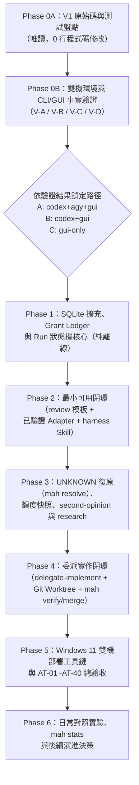

> 這是早期設計文件，現況以 [README](../../README.md) 與 [docs/ADAPTERS.md](../ADAPTERS.md) 為準。

# MultiAgentHarness V2 分階段實作計畫

> **版本：** V2.0-plan（配套 `MultiAgentHarness_V2_Final_Spec.md`）
> **日期：** 2026-11-11（台灣時間）
> **讀者：** 負責執行開發的 Codex Agent，以及負責審核與實測授權的使用者。
> **核心原則：** 先盤點 V1、先驗證外部工具事實、小步漸進交付、隨時可回退、全過程保持 V1 既有 24 項離線測試 100% 通過及 Terra GUI 工作流可用。

---

## 0. Codex 施工守則（防止一次重構整個專案）

> [!CAUTION]
> **給 Codex 的硬性約束：** 在開始任何一階段工作前，必須先閱讀本節。違反施工約束時，必須立即停止相關操作、保存現況並回報。不得自行執行可能丟失使用者變更的 `git reset`、`git clean`、`git checkout --` 等破壞性回退命令。僅在確認變更來源、影響範圍並取得使用者明確授權後，才能執行必要的回退。

### 0.1 嚴禁事項

1. **禁止未盤點先寫碼：** 在完成 Phase 0A 並產出 `docs/v2/V1_INVENTORY.md` 之前，**禁止修改或新增任何 `.py`／`.js`／`.ts`／`.sql` 等程式碼檔案**。
2. **禁止推翻重寫 V1：** 不得以「V2 架構更乾淨」為由刪除、搬移或重寫 V1 已通過測試的模組。V1 已有的 Run ID 產生器、雜湊計算、SQLite 收據讀寫與狀態檢查，**必須以包裝（Wrapper）或增量擴充（Additive Migration）方式重用**。
3. **禁止跨階段偷跑：** 每次只執行使用者指定的一個 Phase（或子階段）。完成該 Phase 的驗收條件後**必須停下來等待使用者確認**，不得自行進入下一階段。
4. **禁止假設 CLI 功能存在：** 在 Phase 0B 實測通過並寫入 `docs/v2/VERIFICATION_REPORT.md` 之前，不得假設 `agy` CLI 已安裝、不得假設 `--effort`／`--json-schema` 等旗標可用，也不得將 `gui-terra` 刪除或降為無法執行的空殼。
5. **禁止觸碰憑證與使用危險旗標：** 嚴禁讀取 `~/.codex`、`~/.gemini` 內的登入憑證檔；嚴禁在任何 Adapter 或測試中加入 `--dangerously-*`、`--skip-permissions` 等繞過權限旗標。

### 0.2 保留 V1 程式與 24 項測試的保護機制

| 保護層 | 具體做法 |
|---|---|
| **V1 測試零修改原則** | V1 現有的 24 項離線測試檔案視為**唯讀契約**。除非經過使用者明確批准，否則不得修改 V1 測試來遷就 V2 程式碼。 |
| **每階段前後回歸測試** | 每個 Phase 開始前與結束時，都必須執行 V1 測試套件，確認 24／24 通過。 |
| **SQLite 自動備份與僅新增遷移** | 對既有 SQLite 資料庫執行任何 Schema 變更前，程式必須先自動複製備份為 `<db_name>.v1.bak.<timestamp>`。V2 遷移腳本只允許 `CREATE TABLE IF NOT EXISTS` 與 `ALTER TABLE ... ADD COLUMN`（可為 NULL 或具預設值），**禁止 `DROP`、`RENAME` 或修改既有欄位型別**。 |
| **V1 GUI 工作流雙軌相容** | `gui-terra` Adapter 必須相容 V1 的 `task.md`、`result.md`、`DONE` 交接格式（Spec §5.2、§10.4）。即使不透過 `mah` 新模板，V1 原有的腳本與人工操作流程也必須能照常運作。 |
| **工作階段變更上限** | 單一 Phase 的程式碼變更（不含規格文件與測試樣本）建議控制在 500–800 行以內；若預估超過，必須先向使用者提出拆分。 |

---

## 1. 階段總覽與依賴關係

| 階段 | 核心產出 | 是否呼叫外部模型 | 前置依賴 |
|---|---|---|---|
| **Phase 0A** | `docs/v2/V1_INVENTORY.md`（V1 結構與 V2 映射表） | 否 | 無 |
| **Phase 0B** | `docs/v2/VERIFICATION_REPORT.md`（決定路徑 A／B／C） | 僅極小 smoke 測試 | Phase 0A + 使用者授權 |
| **Phase 1** | `mah` CLI 骨架、Grant Ledger、狀態機、離線測試 | 否（純離線） | Phase 0A |
| **Phase 2** | `review` 模板、`codex-exec`／`gui-terra`（及條件式 `agy-print`）、Skill | 是（真實驗收 1–2 筆） | Phase 0B + Phase 1 |
| **Phase 3** | `mah resolve`、`quota_snapshots`、`run_costs`、`second-opinion`、`research` | 選用 | Phase 2 |
| **Phase 4** | `delegate-implement`、Workspace Manager（worktree）、`verify`、`merge`/`discard` | 是（真實驗收 1–2 筆） | Phase 3 |
| **Phase 5** | `mah doctor`、`install-skill`、`install-rules`、`prune`、雙機部署與總驗收 | 是（雙機各 1 筆） | Phase 4 |
| **Phase 6** | `mah stats`、匿名 JSONL 匯出、10–20 筆日常對照數據 | 日常使用自然產生 | Phase 5 |

---

## 2. 分階段詳細任務與規格

---

### Phase 0A：V1 原始碼盤點與相容性映射

- **目標：** 完整讀懂 `zm0204/MultiAgentHarness`（commit `3217e8c` 或目前 HEAD）的現有實作，防止重複造輪子或破壞既有介面。
- **前置依賴：** 無。
- **具體任務：**
  1. 檢查 `git status`、`git log -n 5`，確認工作樹乾淨且位於預期 commit。
  2. 執行 V1 現有的 24 項離線測試，記錄執行命令、耗時與通過狀態。
  3. 盤點 V1 所有原始碼檔案，識別：
     - 使用的程式語言、執行環境版本、套件依賴與 CLI 入口。
     - SQLite 資料表結構（表名、欄位、主鍵、索引）與資料庫預設路徑。
     - Run ID 格式、內容雜湊演算法（`task.md`／`result.md`）、狀態列舉值（如 `SUCCEEDED`、`SUBMISSION_UNKNOWN` 等）。
     - 防重複送出邏輯與收據寫入模組。
  4. 建立 V1 與 V2 規格（Spec §5.1、§6.1）的**名稱與欄位映射表**：標明哪些表／欄位／函式在 V1 已存在可直接沿用、哪些需新增欄位、哪些為 V2 全新資料表。
- **預計新增或修改的檔案：**
  - **新增：** `docs/v2/V1_INVENTORY.md`
  - **修改：** 無（本階段**嚴禁**修改任何既有檔案）。
- **驗收條件：**
  - V1 的 24／24 項離線測試通過（`AT-18` 基線）。
  - `docs/v2/V1_INVENTORY.md` 已產出，且明確列出：V1 執行環境命令、V1 資料表與 V2 `runs`/`grants`/`cards` 的具體整合方案、可重用的 V1 函式清單。
- **需要使用者確認的操作：**
  - 審閱 `docs/v2/V1_INVENTORY.md`，確認映射方案無誤後，批准進入 Phase 0B 與 Phase 1。
- **未通過驗證時的回退方案：**
  - 若 V1 24 項測試在未改碼前即失敗，立即停止並回報環境差異（如缺少套件或路徑設定），不擅自修改程式碼。

---

### Phase 0B：雙機環境與 CLI／GUI 事實驗證

- **目標：** 逐項執行 Spec §2.3 的 `V-A1~A9`、`V-B0~B11`、`V-C1~C4`、`V-D1~D4`，以實測證據決定 V2 採用**路徑 A、路徑 B 或路徑 C**（Spec §2.4）。
- **前置依賴：** Phase 0A 完成；**安裝、登入及任何會消耗訂閱額度的測試，必須先取得使用者確認**。
- **具體任務：**
  1. **環境驗證（V-D1~D4）：**
     - 測試 `git worktree add` / `remove` 在本機與外部目錄（如 `D:/mah-worktrees`）是否正常運作（V-D1）。
     - 驗證執行環境版本（V-D2）與 PowerShell UTF-8 中文路徑／stdin 往返（V-D3）。
     - 學校電腦已確認為使用者個人專用電腦（非多人共用電腦，V-D4）：確認家中與學校電腦各自保留本機設定、SQLite、Run 目錄及官方 CLI 管理的登入狀態，且不將這些資料提交至 GitHub。
  2. **Codex CLI 驗證（V-A1~A9）：**
     - 執行唯讀命令 `codex --version`、`codex --help`、`codex exec --help`，記錄實際支援的旗標（V-A1、V-A2）。
     - 請使用者確認 `codex login status` 為訂閱登入（V-A3）。
     - 在使用者事先確認下，執行 1 筆極小唯讀測試（例如回答 `"OK"`），搭配 `--json` 與 `-o`，檢視 JSONL 事件流是否含 thread/session id、token usage、`rate_limits`（V-A2、V-A4、V-A5），並測試從 Codex 工作階段內巢狀呼叫 `codex exec` 的沙箱／網路行為（V-A6）。
     - 驗證 `~/.codex/skills` 漸進載入與 `$harness` 呼叫語法（V-A7）。
     - **關鍵核准驗證（V-A8）：** 實測驗證 Windows 下 `.rules` 的 `prefix_rule(decision="prompt")` 對 `mah grant approve` 的命令攔截是否確實有效，能否透過 Codex 原生權限確認介面讓使用者一鍵批准派工卡。
  3. **Antigravity CLI 驗證（V-B0~B11，已確定列為 Phase 0B 優先驗證項目）：**
     - 先核對官方來源、安裝方式、Windows 支援及 CLI 旗標（V-B0）。
     - **安裝、登入及任何會消耗訂閱額度的測試，必須由使用者事先確認**（V-B1、V-B2、V-B11）。
     - 逐項實測驗證（不得預先假設已通過）：能否選擇模型與思考程度（`agy models` V-B3、`--effort` V-B4）、能否輸出結構化結果（`-p --output-format json` V-B5、`--json-schema` V-B9）、PowerShell stdin 中文 UTF-8（V-B6）、權限處理是否正常且不無限等待（V-B7）、能否以 `--conversation` 查詢或延續對話（V-B10）。
     - **關鍵額度驗證（V-B8）：** 由使用者在派工前後比對 `/usage`（或等效介面），驗證 `agy` 是否確實使用現有 Google AI Pro 訂閱額度池，且無額外 API 計費。
  4. **GUI 基準驗證（V-C1~C4）：**
     - 確認 V1 GUI 流程仍可完成一筆收據（V-C1），記錄前後 Codex 額度變化與耗時（V-C2）、Terra 畫面辨識模型與思考程度能力（V-C3），以及使用者對服務條款的確認結果（V-C4）。
  5. **判定執行路徑（Spec §2.4）：**
     - `V-B1~B8` 驗證成功 $\rightarrow$ **路徑 A**（優先以 CLI 為主要派工介面，Terra GUI 保留備援）。
     - `V-B` 驗證失敗或不適用，但 `V-A2/A6` 通過 $\rightarrow$ **路徑 B**（`codex-exec` + 維持已成功的 Terra GUI 工作流，不阻斷 V2 開發）。
     - `V-A6` 巢狀呼叫受阻且無法透過提權解決 $\rightarrow$ **路徑 C**（維持已成功的 Terra GUI 工作流，搭配 V2 Ledger 與狀態機）。
- **預計新增或修改的檔案：**
  - **新增：** `docs/v2/VERIFICATION_REPORT.md`、`harness.local.example.toml`
  - **修改：** 無正式程式碼修改。
- **驗收條件：**
  - `docs/v2/VERIFICATION_REPORT.md` 中 `V-A`、`V-B`、`V-C`、`V-D` 每項皆有明確實測結果（通過／不支援／不採用），無空白假設。
  - 明確選定路徑 A、B 或 C，並依 `V-A8` 實測結果選定核准模式（首選 `codex_prompt`，未通過則回退為 `manual_cli`；**暫不啟用 `chat_ack`**）。
- **需要使用者確認的操作：**
  - 事先確認並執行或授權：`agy` 安裝與登入（V-B1、V-B2）、Codex 登入狀態檢查（V-A3）、訂閱扣量前後比對（V-B8）、條款確認（V-B11、V-C4）、所有會消耗訂閱額度的測試。
- **未通過驗證時的回退方案：**
  - 若 `agy` 驗證失敗或不適用（無法安裝、卡在互動授權或未使用訂閱額度池）：維持已成功的 Terra GUI 工作流（走**路徑 B** 或**路徑 C**），不阻斷 V2 開發。
  - 若 `V-A8`（`codex_prompt` 規則攔截）在 Windows 下無法可靠提供使用者確認：**回退到 `manual_cli`**（由使用者手動執行核准命令）；**暫不啟用 `chat_ack` 自動回退**，以避免 LLM 自行核准造成 Grant Ledger 的授權保證失效。

---

### Phase 1：SQLite 無損擴充、Grant Ledger 與 Run 狀態機核心（純離線）

- **目標：** 實作 V2 的安全核心（Spec §4.2、§4.3、§4.4、§5.1、§6.1–6.3、§7.4），全部透過離線單元與整合測試驗證，**不呼叫任何外部模型**。
- **前置依賴：** Phase 0A 完成（可與 Phase 0B 平行進行開發，但預設值依 Phase 0B 填入）。
- **具體任務：**
  1. **設定檔載入器：** 實作讀取 `harness.local.toml`，並檢查 `[limits]` 硬上限（`max_concurrency` 強制鎖定為 1，大於 1 時發出警告並覆寫為 1）。
  2. **SQLite 備份與無損遷移：**
     - 依 `V1_INVENTORY.md` 對接 V1 資料庫。
     - 實作自動備份與新增表（`schema_meta`、`cards`、`grants`、`run_events`、`quota_snapshots`、`run_costs`、`suggestions`）及 V1 收據表的擴充欄位（或關聯 `runs` 表）。
  3. **派工卡與建議次數限制（`mah card` / `mah suggest`）：**
     - 實作 `mah card create/show/reject` 與選用的 `mah suggest log`。
     - 檢查 `trigger_ids` 必填（`AT-39`）、`[limits]` 硬上限（回傳碼 16，`AT-06`）、同一 `task_key` 建議次數上限 2 次（第 3 次警告並要求 `--override-suggestion-limit`，`AT-40`）。
     - 產生 ≤ 8 行的可讀派工卡與 `content_sha256`（Spec §5.5）。
  4. **Grant Ledger（`mah grant`）：**
     - 實作 `mah grant approve <card_id> --sha <sha> --via <codex_prompt|manual_cli>`、`show`、`close`、`list`（V2 僅接受 `codex_prompt` 與 `manual_cli`，拒絕 `chat_ack`）。
     - 驗證 `--sha` 一致性（`AT-08`）；核准新卡時將同一 repo 既有 `ACTIVE` grant 轉為 `SUPERSEDED`，剩餘筆數不轉移（`AT-10`）。
     - 實作 `BEGIN IMMEDIATE` 原子交易 `check_and_reserve()`：檢查 `ACTIVE`、未過期（回傳碼 12）、template/adapter/model/effort 在允許範圍內（回傳碼 10）、`used_dispatches < max_dispatches`（回傳碼 11）、全域無其他非終止狀態 run（回傳碼 13）。
     - 實作筆數歸還規則：僅在 `CANCELLED` 與 `FAILED_PRE_SUBMIT` 時將 `used_dispatches - 1`（`AT-14`）。
  5. **Run Manager 與狀態機骨架：**
     - 實作 Spec §6.1 狀態轉換與 `run_events` 寫入。
     - 實作 `PREPARED → LAUNCHING` 的條件更新（`WHERE state='PREPARED'`，`AT-11`）。
     - 實作啟動掃描：將孤兒 `LAUNCHING`/`RUNNING`（程序已不存在）自動轉為 `SUBMISSION_UNKNOWN`（`AT-12`）。
     - 實作原子檔案寫入工具（先寫 `.tmp` 再 rename，`DONE` 最後寫入，`AT-16`）。
- **預計新增或修改的檔案**（實際路徑依 Phase 0A 盤點的 V1 目錄結構調整）：
  - **新增：**
    - `mah/`（或 V1 既有套件目錄下的 `v2/` 子模組）：`cli.py`、`config.py`、`db.py`、`ledger.py`、`state_machine.py`、`atomic_io.py`、`exit_codes.py`
    - `tests/v2/test_ledger.py`、`tests/v2/test_state_machine.py`、`tests/v2/test_atomic_io.py`
  - **僅允許擴充／包裹：** V1 資料庫連線或 Run ID／雜湊工具模組（保持原函式簽名不變）。
  - **禁止修改：** V1 既有 24 項測試檔案。
- **驗收條件：**
  - V1 24／24 項離線測試通過（`AT-18`）。
  - 首筆 `agy-print` Smoke Test 前，先離線驗證卡片雜湊及 Grant 綁定逾時、工作樹和任務雜湊。確認舊 Grant、參數變動與 Windows 工作樹別名都無法擴大授權，並保留原有收集與復原行為。
  - V2 新增離線測試通過：`AT-03`、`AT-04`、`AT-05`、`AT-06`、`AT-07`、`AT-08`、`AT-10`、`AT-11`、`AT-12`、`AT-14`、`AT-16`、`AT-17`、`AT-19`、`AT-24`、`AT-39`、`AT-40`。
- **需要使用者確認的操作：**
  - 檢視測試報告，確認結束碼（0、2、10–17、20–21、30）與派工卡輸出格式符合預期。
- **未通過驗證時的回退方案：**
  - 若資料庫遷移影響 V1 測試：以自動備份的 `.v1.bak` 還原資料庫，改用獨立的 `v2_runs` 關聯表（以 `run_id` 外鍵連接 V1 收據表），完全不觸碰 V1 原表結構。

---

### Phase 2：最小可用閉環 — `review` 模板、Adapter 接入與 `harness` Skill

- **目標：** 打通第一個端到端真實場景（`review` 跨模型唯讀審查），完成 Adapter 介面、禁止旗標防護与原生 `harness` Skill。
- **前置依賴：** Phase 0B 與 Phase 1 完成。
- **具體任務：**
  1. **Adapter Registry 與安全防護（Spec §4.5、§10.1）：**
     - 實作 `probe()`（只用 `--version`/`--help`，`AT-28`）、`build_invocation()` 純函式与禁止旗標攔截（含 `dangerously`、`skip-permissions`、`bypass` 一律回傳 17，`AT-21`）。
     - 檢查必要旗標缺失時回傳 15，選用旗標缺失時降級並記錄（`AT-29`）。
     - 記錄 `model_requested` 與 `model_observed`（觀察不到時填 `unknown`，不得複製請求值，`AT-20`）。
  2. **`review` 模板與 Verifier（Spec §9.2）：**
     - 建立 `templates/review/template.toml`、`task.md.tmpl`、`result.schema.json`。
     - 實作 `mah collect`、`mah accept --adopted N --total M`、`mah reject-result`。
     - 實作唯讀違規檢查：執行後若工作區 `git status` 有變更（非預期檔案異動），判定為 `FAILED (readonly_violation)`（`AT-22`）。
  3. **實作已驗證的 Adapter：**
     - **`codex-exec`（路徑 A/B）：** 依 V-A2/A4 結果組裝 `-s read-only`、`--json`、`-o`，透過 stdin 傳入 `task.md`，校準 `PRE_SUBMIT` 錯誤樣式清單（`AT-15`）。
     - **`gui-terra`（路徑 A/B/C 皆必備）：** 實作 `<gui_workspace_root>/runs/<run_id>/task.md` 與 `handoff.json` 輸出；實作 `mah gui mark <run_id> --launching|--submitted|--not-submitted|--unclear`；支援將 V1 `result.md` 轉換為 `result.json (legacy_v1: true)`（`AT-31`、`AT-33`）。
     - **`agy-print`（僅路徑 A 實作）：** 依 V-B 實測結果組裝命令，搭配 `disposable_worktree` 確保唯讀安全（`AT-32`）。
  4. **撰寫 `harness` Skill（Spec 附錄 B）：**
     - 建立 `skills/harness/SKILL.md`（frontmatter `description` ≤ 300 字元，全文 ≤ 400 行，`AT-01`）與 `skills/harness/references/`（觸發條件表、卡片 JSON 格式、GUI 交接規則、不受信任資料守則）。
- **預計新增或修改的檔案：**
  - **新增：**
    - `mah/adapters/base.py`、`mah/adapters/codex_exec.py`、`mah/adapters/gui_terra.py`、`mah/adapters/agy_print.py`（視路徑 A 而定）
    - `mah/verifier.py`
    - `templates/review/template.toml`、`templates/review/task.md.tmpl`、`templates/review/result.schema.json`
    - `skills/harness/SKILL.md`、`skills/harness/references/commands.md`、`skills/harness/references/gui_rules.md`
    - `tests/v2/fake_cli/`（模擬正常、逾時、崩潰、亂碼、schema 錯誤的假 CLI 腳本）
    - `tests/v2/test_adapters.py`、`tests/v2/test_review_flow.py`
- **驗收條件：**
  - V1 24／24 測試通過（`AT-18`）。
  - 離線／假 CLI 測試通過：`AT-01`、`AT-15`、`AT-20`、`AT-21`、`AT-22`、`AT-28`、`AT-29`。
  - 真實派工驗收（需使用者在場授權）：
    - `AT-02`：一般單 Agent 任務不觸發任何 `mah` 呼叫。
    - `AT-09`：核准提示拒絕時不建立 grant（若採 `codex_prompt`）。
    - `AT-30`：`codex-exec` 真實唯讀 `review` 1 筆 `SUCCEEDED`。
    - `AT-31` & `AT-33`：`gui-terra` 真實唯讀 `review` 1 筆 `SUCCEEDED`，且測試模型不符時不送出並歸還筆數。
    - `AT-32`：（僅路徑 A）`agy-print` 真實唯讀 `review` 1 筆 `SUCCEEDED`。
- **需要使用者確認的操作：**
  - 核准 2–3 筆真實 `review` 派工卡，並在 GUI 測試時在場觀察 Terra 操作。
- **未通過驗證時的回退方案：**
  - 若 CLI Adapter 在真實派工時因編碼或沙箱問題失敗：先以 `gui-terra` 作為唯一啟用 Adapter，確保 Phase 2 閉環可用，再單獨修復 CLI 子程序環境。

---

### Phase 3：`SUBMISSION_UNKNOWN` 復原程序、額度快照與進階唯讀模板

- **目標：** 完成 `mah resolve` 異常復原（Spec §6.4）、被動額度快照與成本紀錄（Spec §12），以及 `second-opinion`、`research` 兩個唯讀模板（Spec §9.3、§9.4）。
- **前置依賴：** Phase 2 完成。
- **具體任務：**
  1. **`mah resolve <run_id>` 復原程序（Spec §6.4）：**
     - 實作四步證據收集：檢查 `DONE` 與結果檔 $\rightarrow$ 檢查 `pid` 與啟動時間 $\rightarrow$ 呼叫 Adapter `resolve_evidence()`（檢查 `conversation_id` 與工作區異動）$\rightarrow$ 輸出證據摘要。
     - 實作使用者明確旗標：`--attach`（延續原對話，需 grant 仍為 `ACTIVE`）、`--mark-failed`、`--abandon`、`--redispatch`（建立新 run，`parent_run_id` 指向原 run，扣 1 筆新額度）。
     - 強制驗證：未帶使用者動作旗標時，`mah resolve` **只輸出證據，絕不自動重送或延續**（`AT-13`）。
  2. **額度快照與協作成本紀錄（Spec §12）：**
     - 實作從 `codex-exec`（及 `agy-print`）JSON 事件自動擷取 `quota_snapshots`（`source='cli_json'`），以及 `mah quota add/show` 手動登錄（`source='user_entered'`）。
     - 實作快照過期判定（超過 `resets_at` 或 `window_minutes` 標示「過期」；無資料標示 `unknown`；不同平台絕不相加，`AT-34`、`AT-35`）。
     - 實作 `run_costs` 自動寫入（`wall_ms`、token 數、`gui_steps`、`verify_wall_ms`、`first_pass_accepted`、`adopted_findings`/`total_findings`）。
  3. **`second-opinion` 與 `research` 模板（Spec §9.3、§9.4）：**
     - 新增兩個模板的 `template.toml`、`task.md.tmpl`、`result.schema.json`（含檔案與行號引用格式檢查）。
- **預計新增或修改的檔案：**
  - **新增：**
    - `mah/resolver.py`、`mah/quota.py`
    - `templates/second-opinion/*`、`templates/research/*`
    - `tests/v2/test_resolver.py`、`tests/v2/test_quota.py`、`tests/v2/test_templates_readonly.py`
  - **修改：** `mah/cli.py`（掛載 `resolve`、`quota` 子命令）、`mah/ledger.py`（派工卡整合額度快照顯示）。
- **驗收條件：**
  - V1 24／24 測試通過（`AT-18`）。
  - V2 測試通過：`AT-13`、`AT-25`（唯讀模板部分）、`AT-34`、`AT-35`。
  - 模擬中斷測試：啟動假 CLI 後強制 `kill` `mah` 程序，重啟後確認轉為 `SUBMISSION_UNKNOWN`，並分別測試 `--mark-failed`、`--abandon`、`--redispatch` 行為正確。
- **需要使用者確認的操作：**
  - 審閱 `mah resolve` 的輸出格式是否清晰易懂。
- **未通過驗證時的回退方案：**
  - 若某 CLI 不支援 `--attach`（例如 V-B10 為 `none`），在該 Adapter 上停用 `--attach` 選項（回傳明確提示），僅開放 `--mark-failed`、`--abandon`、`--redispatch`。

---

### Phase 4：委派實作閉環 — `delegate-implement`、Git Worktree 隔離與實際測試驗收

- **目標：** 完成可寫入型派工 `delegate-implement`（Spec §9.5）、Workspace Manager 的 Git worktree 隔離（Spec §11.1），以及不採信工作者自述的 `mah verify` 獨立測試驗收與 `mah merge`／`mah discard`。
- **前置依賴：** Phase 3 完成。
- **具體任務：**
  1. **Workspace Manager（Spec §11.1）：**
     - 實作 `worktree`（`git worktree add -b mah/<run_id> <worktree_root>/<run_id> <base_commit>`）與 `disposable_worktree`（`--detach`）的建立、狀態檢查與清理。
     - 記錄 `base_commit` 至 `runs` 表與 `task.md`。
  2. **`delegate-implement` 模板（Spec §9.5）：**
     - 建立 `templates/delegate-implement/template.toml`、`task.md.tmpl`、`result.schema.json`。
     - 強制檢查 `task.md` 必須宣告至少一條驗收命令。
  3. **獨立驗收器 `mah verify <run_id>`（Spec §4.7、§9.5）：**
     - 檢查驗收命令是否符合 `harness.local.toml` 的 `[verify].allowed_command_prefixes`，不符時拒絕執行（`AT-23`）。
     - 在 worktree 內**由 `mah` 親自重新執行驗收命令**，記錄真實 `exit_code` 與輸出摘要至 `verify.json`，完全不採信工作者 `result.json` 自報的 `commands_run`（`AT-26`）。
     - 產生 `diff.patch` 與 `git diff --stat`，並比對變更檔案是否超出 `task.md` 允許範圍（標記 `out_of_scope_files`）。
  4. **合併與捨棄（`mah merge` / `mah discard`）：**
     - 限制只有 `state='SUCCEEDED'` 且 `acceptance_status='ACCEPTED'` 的 `worktree` run 可執行 `mah merge`。
     - `mah merge` 檢查主工作樹是否乾淨且能否無衝突套用；若有衝突則拒絕合併並保留 worktree 交回 Controller 處理（`AT-27`）。
     - `mah discard` 將 `acceptance_status` 設為 `DISCARDED` 並安全移除 worktree。
- **預計新增或修改的檔案：**
  - **新增：**
    - `mah/workspace.py`
    - `templates/delegate-implement/template.toml`、`templates/delegate-implement/task.md.tmpl`、`templates/delegate-implement/result.schema.json`
    - `tests/v2/test_workspace_worktree.py`、`tests/v2/test_delegate_implement.py`
  - **修改：** `mah/verifier.py`、`mah/cli.py`（掛載 `verify`、`merge`、`discard`）。
- **驗收條件：**
  - V1 24／24 測試通過（`AT-18`）。
  - V2 測試通過：`AT-23`、`AT-25`（全部四種模板）、`AT-26`、`AT-27`。
  - 真實派工驗收：在測試分支上派工 1 筆小型 `delegate-implement` 任務，驗證 worktree 隔離、`mah verify` 重跑測試、`mah accept` 與 `mah merge` 完整閉環。
- **需要使用者確認的操作：**
  - 核准 1 筆真實 `delegate-implement` 派工卡，並檢視 `diff.patch` 與 `verify.json`。
- **未通過驗證時的回退方案：**
  - 若在特定環境下 `git worktree` 因檔案鎖定（如防毒軟體或 IDE 索引）移除失敗：`mah discard`/`merge` 改為先將分支標記為已處理並列入 `mah prune` 待清理佇列，不阻塞主流程。

---

### Phase 5：Windows 11 雙機部署工具鏈與 AT-01~AT-40 總驗收

- **目標：** 完成跨電腦穩定運作所需的診斷、安裝、清理工具與部署文件（Spec §13），並在家中與學校兩台 Windows 11 電腦完成總驗收（Spec §14）。
- **前置依賴：** Phase 4 完成。
- **具體任務：**
  1. **`mah doctor` 與 `mah probe`（Spec §4.2、§11.1、§13.3）：**
     - 檢查系統環境、Git worktree 可用性、PowerShell UTF-8 設定、各 Adapter 版本與 `probe()` 結果、V1 24 項測試入口。
     - 檢查 `state_dir` 與 `worktree_root` 是否位於 repo 外，並偵測是否落在 `OneDrive`、`Dropbox`、`Google Drive`、`iCloud` 等雲端同步目錄下；若是則發出醒目警告（`AT-37`）。
     - 支援 `mah doctor --smoke --grant <id>` 執行極小唯讀測試。
  2. **`mah install-skill`、`mah install-rules` 與 `mah prune`：**
     - `install-skill`：以檔案複製方式（不使用 symlink）將 `skills/harness` 安裝至使用者層級 Skill 目錄（需使用者確認）。
     - `install-rules`：預覽並在使用者確認後寫入 Codex `.rules`（如 `mah grant approve` 設為 `prompt`）。
     - `prune`：清理超過 `retain_run_dirs_days` 的舊 run 目錄與殘留 worktree。
  3. **Windows 路徑與編碼壓力測試：**
     - 測試含空白、中文與特殊字元的目錄路徑及提示詞往返（`AT-36`）。
  4. **雙機部署文件與總驗收：**
     - 撰寫 `docs/v2/DEPLOYMENT_WINDOWS.md`：載明家中與學校電腦均為個人專用電腦，正常保留各官方 CLI 管理的登入狀態，不需要預設每次工作結束強制執行 `codex logout` 或 `agy logout`；但嚴格保護本機憑證（不讀取、複製或記錄認證資料），且兩台電腦各自保留本機設定、SQLite、Run 目錄及登入狀態，絕不提交至 GitHub。
     - 執行 `AT-01` 至 `AT-40` 全套驗收清單，並在第二台電腦（學校或家中另一台）依文件從零設定 `harness.local.toml` 完成至少 1 筆真實派工（`AT-38`）。
- **預計新增或修改的檔案：**
  - **新增：**
    - `mah/doctor.py`、`mah/installer.py`、`mah/pruner.py`
    - `docs/v2/DEPLOYMENT_WINDOWS.md`
    - `tests/v2/test_doctor_and_windows.py`
  - **修改：** `.gitignore`（確認排除 `harness.local.toml`、`.mah/`、`*.db`、`*.bak*`）。
- **驗收條件：**
  - Spec §14.2 V2 完成標準第 1–5 點全部達成：
    - V1 24／24 離線測試通過（`AT-18`）。
    - `AT-01` ~ `AT-31`、`AT-33` ~ `AT-40` 全部通過（路徑 A 下含 `AT-32`）。
    - 兩台 Windows 11 電腦皆完成 `VERIFICATION_REPORT.md` 與真實派工，且 `git status` 無機器專屬設定或憑證外洩（`AT-38`）。
- **需要使用者確認的操作：**
  - 確認 `install-skill` 與 `install-rules` 的寫入目標，並在兩台電腦上各執行一次 `mah doctor` 與真實派工驗收。
- **未通過驗證時的回退方案：**
  - 若因環境權限限制無法寫入使用者全域目錄：支援專案級 `.agents/skills` / `.codex/rules` 本地載入。

---

### Phase 6：日常對照實驗、成本效益統計與演進決策

- **目標：** 落實架構審查報告 P0-2 的「協作淨收益量測」，以真實日常數據驗證哪些觸發條件與模板真正划算，避免無效的多 Agent 開銷。
- **前置依賴：** Phase 5 完成（V2 已投入日常自用）。
- **具體任務：**
  1. **實作 `mah stats` 與匿名匯出（Spec §4.2、§11.3）：**
     - 依模板、Adapter、模型、思考程度、觸發條件（`T1~T5`）彙整：派工次數、首次驗收通過率（`first_pass_accepted`）、平均返工次數、`review` 建議採納率（`adopted_findings / total_findings`）、平均牆鐘耗時、工作階段前後額度變化。
     - 實作 `mah stats --export-jsonl <file>`：僅匯出不含路徑、提示詞與程式碼的統計欄位，供家中與學校兩台電腦合併分析。
  2. **執行 10–20 筆日常任務對照觀察：**
     - 在 2–4 週日常開發中累積真實紀錄。
     - 檢視停止條件（Go/No-Go）：
       - 若某模板（例如 `research` 或特定模型下的 `delegate-implement`）首次驗收率低於 60%，或耗費的驗證／重工時間高於 Controller 自己處理，則在 `harness.local.toml` 將該觸發條件門檻調高或停用。
       - 若 `review` 模板採納率穩定且從未發生越權，使用者可於此時決定是否啟用「常設授權（`kind='standing'`）」或評估延後功能（Spec §15）。
- **預計新增或修改的檔案：**
  - **新增：** `mah/stats.py`、`tests/v2/test_stats.py`
- **驗收條件：**
  - `mah stats` 能正確計算各維度指標，且匯出的 JSONL 通過隱私掃描測試（不含敏感字串）。
- **需要使用者確認的操作：**
  - 根據 `mah stats` 報表調整 `harness.local.toml` 中的 `[defaults]` 與 `[triggers]` 門檻。
- **未通過驗證時的回退方案：**
  - 若數據顯示某條協作路徑為負收益，只需修改 `harness.local.toml` 停用該觸發條件或 Adapter，無須修改程式碼。

---

## 3. 正式規格書（`MultiAgentHarness_V2_Final_Spec.md`）疑義與矛盾集中清單

遵循你的要求，以下列出在審閱 Opus 所撰寫的 `MultiAgentHarness_V2_Final_Spec.md` 時發現的 **6 項細部介面疑義或潛在矛盾**。我**沒有**擅自大幅改動正式規格書，而是在本計畫中將其集中列出，並提供建議的工程實作解釋（Codex 在實作對應階段時應直接採納下列處置）：

| # | 涉及章節 | 規格中的疑義或潛在矛盾 | 建議的工程實作處置（不破壞規格精神） |
|---|---|---|---|
| **D-1** | §5.2 vs §5.3 vs §10.2 | **唯讀模式下工作者能否檢查 `DONE` 檔：** §5.3 的 `task.md` 範本要求工作者「開始工作前，先檢查 `runs/<RUN_ID>/DONE` 是否已經存在」，但 §5.2 規定 CLI 路徑的 Run 目錄在 repo 外的 `<state_dir>/runs/<run_id>/`，且 `codex-exec` 在 `-s read-only` 沙箱下無法存取 repo 外的 `<state_dir>`，也不負責寫入 `DONE`（CLI 路徑的 `DONE` 是由 `mah` 在收集完輸出後最後寫入）。 | **區分 CLI 與 GUI 的冪等檢查責任：** 在 CLI Adapter（`codex-exec`、`agy-print`）下，由 `mah` 在啟動子程序前檢查 `<state_dir>/runs/<run_id>/DONE` 與 SQLite 狀態；`task.md` 內的「檢查 `runs/<RUN_ID>/DONE`」段落僅在 `gui-terra`（固定工作區內相對路徑）渲染時附加。 |
| **D-2** | §4.2 vs §6.1 vs §10.4 | **`mah dispatch` 與 `mah collect` 在 CLI 路徑下的同步邊界：** §4.2 將 `dispatch` 與 `collect` 列為兩個獨立命令，但 `codex exec` 與 `agy -p` 本質上是阻塞式前景程序；在 Windows PowerShell 與 Codex 沙箱內若把子程序放到背景執行，命令結束時子程序容易被沙箱回收或遺失 stdout JSONL 串流。 | **CLI 同步執行、GUI 分步輪詢：** 當 Adapter 為 `codex-exec` 或 `agy-print` 時，`mah dispatch` 在同一程序內同步等待 CLI 執行完畢並直接呼叫內部 `collect()` 完成狀態轉換；獨立的 `mah collect <run_id>` 命令則保留給 `gui-terra` 輪詢 `DONE` 以及 `SUBMISSION_UNKNOWN` 復原後手動收集使用。 |
| **D-3** | §4.2 vs §5.1 vs §7.3 | **`mah suggest log` 未列於 §4.2 CLI 總表：** §5.1 定義了 `suggestions` 表，§7.3 提到可用 `mah suggest log` 記錄預先詢問結果，AT-40 要求檢查同一 `task_key` 的建議次數上限，但 §4.2 命令總表漏列了 `mah suggest log`。 | **在 Phase 1 一併實作：** 除了在 `mah card create` 自動寫入一筆 `suggestions (stage='card')` 外，補齊 `mah suggest log --task-key <k> --trigger <T*> --stage prep_ask --outcome <accepted\|rejected\|ignored>`，確保預先詢問被拒時也能計入同一 `task_key` 的最多 2 次上限。 |
| **D-4** | §4.2 vs §10.4 | **`mah gui mark` 缺少 `--launching` 參數說明：** §10.4 第 2 步要求「Controller 執行 `mah gui mark <run_id> --launching`，run 轉為 `LAUNCHING`」，但 §4.2 的參數表只寫了 `--submitted｜--not-submitted｜--unclear`。 | **以 §10.4 流程為準：** 在 Phase 2 實作 `mah gui mark` 時，完整支援 `--launching`、`--submitted`、`--not-submitted`、`--unclear` 四個狀態旗標。 |
| **D-5** | §8 vs §12.1 | **T4（額度偏高觸發卸載）的冷啟動死鎖：** §8 規定「沒有額度快照時不得以 T4 為理由」，而 §12.1 規定「不主動輪詢，快照來自派工後的 `cli_json` 或使用者手動輸入」。這意味著在完成第一筆派工前，系統沒有 `cli_json` 快照，T4 永遠無法作為第一筆派工的觸發原因。 | **明確使用方式：** 維持「不主動輪詢」原則；在 Skill 與文件中載明：若使用者在日常對話中發現 Codex 額度吃緊，可執行一次 `mah quota add` 登錄當前百分比以解鎖 T4，或直接以 T5（使用者明確要求）發起派工。 |
| **D-6** | §5.1 vs §6.2 | **`runs.acceptance_status` 的狀態轉換約束：** §6.2 規定「只有 `SUCCEEDED` 的 run 可以進入 `ACCEPTED`；只有 `workspace_kind='worktree'` 的 run 可以 `MERGED`」，但 §5.1 的 SQL `CHECK` 只限制了列舉值。 | **在應用層與資料庫 Trigger／交易中雙重檢查：** 在 `mah accept` 與 `mah merge` 中強制檢查 `runs.state == 'SUCCEEDED'` 與 `workspace_kind == 'worktree'`，違反時回傳明確錯誤碼，並納入 Phase 1／Phase 4 單元測試。 |
